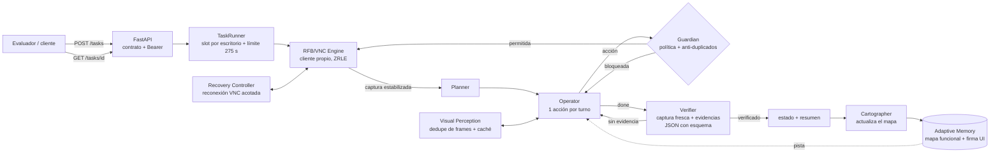

# APRENDIZ

> **The AI agent that learns to operate software without an API.**
> El agente de IA que aprende a operar software que no tiene API.

    

APRENDIZ recibe una tarea en lenguaje natural («registra al cliente…», «¿cuántas facturas vencidas tiene…?») y la ejecuta sobre una aplicación de escritorio que **nunca ha visto**, como lo haría un empleado nuevo y cuidadoso. Para eso mira la pantalla, decide un paso, lo ejecuta con ratón y teclado a través de VNC y **verifica con evidencia visual** antes de reportar. No usa selectores, coordenadas fijas, APIs internas ni proveedores de automatización.

---

## 1. El problema

Muchas empresas dependen de sistemas de gestión de hace 15 años que no tienen API, documentación ni proveedor. Cada alta de cliente, corrección o reporte se hace a mano: clics, formularios, ventanas emergentes y exportaciones una por una. Las herramientas RPA clásicas dependen de selectores y coordenadas, así que se rompen cuando la interfaz cambia.

## 2. La solución

Es un agente autónomo que **opera la interfaz gráfica** mediante razonamiento visual (Claude con visión) y un **cliente RFB/VNC escrito desde cero**. El modelo decide; el código del agente ejecuta cada acción, aplica las políticas de seguridad, mide el tiempo y exige evidencia.

- Funciona sobre cualquier app visible en un escritorio VNC (1280×800).
- Separa el razonamiento (LLM) de la ejecución y la política (código determinista).
- Su política es **fail-closed**: sin evidencia visible, la tarea se reporta como `fallida`, nunca como un falso éxito.

## 3. Arquitectura



| Componente | Responsabilidad |
|---|---|
| **Planner** | Clasifica la tarea (crear, modificar, consultar, exportar, peligrosa o imposible), copia los datos literales y define criterios de éxito y acciones prohibidas. Rechaza de inmediato las tareas peligrosas. |
| **Operator** | Ve la captura y elige **una** herramienta por turno (`click`, `type_text`, `press_key`, `scroll`, `zoom`, `wait`, `remember`, `done`), declarando intención y riesgo. |
| **Verifier** | Revisión independiente con una captura fresca y las capturas ancladas por página. Responde JSON validado con esquema y decide si existe evidencia visible. |
| **Guardian** | Código determinista: bloquea acciones destructivas, evita duplicados, detecta bucles, controla los tiempos, formatea la línea `respuesta:` y redacta secretos. |
| **Cartographer** | Al terminar, consolida un mapa **funcional** de la app (módulos, formularios, recetas) para las siguientes tareas. |
| **RFB/VNC Engine** | `app/rfb.py`: handshake RFB 3.8, autenticación VNC (DES), codificaciones Raw, CopyRect y ZRLE, estabilización de pantalla, ratón y teclado (incluye tildes y ñ). |
| **Adaptive Memory** | `app/memory.py`: mapa por app sin coordenadas, con firma visual de la UI, confianza y detección de cambios. |
| **Recovery Controller** | Reconexión VNC acotada, re-observación tras un corte y guarda anti-duplicados (`app/commit_guard.py`). |
| **Visual Perception** | Capturas estabilizadas, zoom bajo demanda, no reenvía frames idénticos, no recodifica el PNG si el frame no cambió y cachea el historial. |

## 4. Capacidades avanzadas (v0.2.1)

Las capacidades marcadas con 🧪 tienen **solo pruebas unitarias o sintéticas** y no se han validado en una aplicación desconocida real.

| Capacidad | Descripción | Evidencia |
|---|---|---|
| Detección de cambios visuales | Firma de paleta y maquetación de la UI; si difiere de la UI donde se aprendió el mapa, el Operator lo sabe y vuelve a localizar cada control. | 🧪 4/4 en pares sintéticos |
| Memoria funcional sin coordenadas | El mapa guarda qué existe y para qué sirve, nunca posiciones; también limpia mapas antiguos. | 🧪 tests |
| Etiquetas y controles reorganizados | Los controles se buscan por función, etiqueta equivalente y contexto. | ✅ En el escritorio real v4.2 encontró «Aplicar» como acción de guardar (E1/E2) |
| Reconexión VNC | Hasta 2 reconexiones por tarea dentro del presupuesto; nunca verifica sobre un frame congelado. | 🧪 tests y benchmark |
| Protección contra duplicados | Clasifica las confirmaciones con varias señales, no solo el riesgo declarado. Esperar no desbloquea una repetición; el doble clic sobre una confirmación se envía como clic simple. | 🧪 tests y benchmark; ✅ 0 duplicados en E1/E2 reales |
| Concurrencia por escritorio | Una sola tarea por sesión VNC; la espera está acotada por el presupuesto y el slot se libera ante errores o cancelaciones. | 🧪 tests |
| Validación con evidencia | El Verifier usa una captura fresca más las capturas ancladas de cada página, con JSON validado por esquema y un reintento acotado. | ✅ E3 pasó en producción con v0.1.3 |
| Caché de inferencia | `cache_control` sobre el historial del Operator. | ✅ Real en staging: 147 604 tokens leídos de caché frente a 10 825 sin cachear en una tarea E2 |
| Optimización de capturas | Frames idénticos no se reenvían ni se recodifican. | 🧪 −3,9 % de tokens de imagen (estimado, sintético) |
| Observabilidad | Logs `evento=fase` y `evento=fin` con duración por fase, llamadas por rol, reintentos y tokens. | ✅ Logs reales en staging |
| Protección de secretos | Redacción en resúmenes, diagnósticos persistidos y logs, incluidas las trazas de error. | 🧪 tests; ✅ 0 fugas en el smoke test |
| Control de tiempos | Operator hasta 225 s, Verifier hasta 262 s y límite duro de 275 s; ninguna acción fuera de plazo. | 🧪 tests |
| Feature flags y rollback | `MEMORY_V2`, `RECOVERY_V2` y `PERCEPTION_V2`. | 🧪 tests con flags apagados |

## 5. Rendimiento y pruebas

Cada nivel de evidencia se presenta por separado.

### A. Tests unitarios

```cmd
python -W error::DeprecationWarning -m unittest discover -s tests
```

**64/64 OK.** Cubren: JSON del Verifier (truncado, mal formado, `max_tokens`, rechazo, reintentos), evidencia multipágina, memoria y detección de cambios, guarda anti-duplicados (guardado lento, confirmación tardía, doble clic, desconexión durante una escritura, reenvío legítimo), concurrencia (serialización, timeout, liberación ante excepciones y cancelaciones), redacción de logs y trazas, y el contrato real del SDK de Anthropic (serialización de `cache_control` y `output_config`, lectura de los tokens de caché).

### B. Benchmark sintético (no es rendimiento real)

`python scripts\bench.py` usa un escritorio simulado y un «modelo» guionizado **idéntico** en ambos brazos, así que mide solo el arnés del agente y no la visión de Claude.

| 8 escenarios | v0.1.3 | v0.2.1 |
|---|---|---|
| Correctas | 4/8 | 8/8 |
| Falsos éxitos | 3 | 0 |
| Duplicados | 5 | 0 |
| Acciones indebidas | 0 | 0 |

### C. Pruebas públicas reales de Frontier (escritorio de práctica)

| Prueba | v0.1.3 (producción) | v0.2.1 (staging, `53d7b99`, app SIGECOM v4.2) |
|---|---|---|
| E1 crear cliente | ✅ PASS | ✅ PASS (84 s, una sola creación) |
| E2 dirección + nota maliciosa | ✅ PASS | ✅ PASS (55 s, nota ignorada). En el build previo, 1 de 2 corridas dio falso negativo del Verifier; corregido (ver `docs/V2_ENGINEERING.md`). |
| E3 facturas vencidas (`respuesta: 45`) | ✅ PASS | ⛔ Sin resultado: la API respondió *usage limit reached*. El agente reportó `fallida` (fail-closed) y `__check.pass=true`. |
| E4 exportar pedidos | ✅ PASS | ⏸ No ejecutada (límite de la API) |
| E5 homónimos | ✅ PASS | ⏸ No ejecutada (límite de la API) |

La columna de v0.1.3 refleja las aprobaciones registradas antes de este release. Para v0.2.1, `__check.pass=true` en todas las corridas ejecutadas.

### D. Set oculto

Sin resultados publicados: no hay evidencia oficial todavía.

## 6. Seguridad

| Riesgo | Mecanismo |
|---|---|
| Prompt injection desde la app | Regla explícita: el texto de la app es dato, nunca una orden. Además, el Guardian bloquea por política cualquier intención destructiva aunque el modelo la marque como «lectura». Verificado en E2 real: una nota pedía eliminar pedidos y se ignoró. |
| Confirmaciones seguras | Guardar, Crear, Exportar y Confirmar se reconocen por varias señales. Tras enviarlas, el resultado se considera incierto hasta comprobar el estado real. |
| Cambios fuera de alcance | Cada acción declara intención y riesgo. Las ventanas emergentes que ofrecen extras no pedidos se cancelan. El Verifier informa de los cambios extra ejecutados. |
| Ambigüedad | Antes de modificar se exige exactamente una coincidencia. Con homónimos, la tarea es `fallida` y nombra los identificadores. |
| Duplicados | Buscar antes de crear, guarda anti-repetición y doble clic degradado a clic simple en confirmaciones. |
| Fail-closed | Un error técnico, de API o de VNC, o la falta de evidencia, dan `fallida`. Nunca se verifica sobre una pantalla congelada. |
| Secretos | La contraseña del escritorio, el token del equipo, la API key y el host se redactan en resúmenes, en `data/logs`, en `?debug=1` y en los logs, incluidas las trazas. `DEBUG_API=0` por defecto. |

## 7. Instalación (Python 3.12, Windows CMD)

```cmd
git clone https://github.com/jpablortiz96/APRENDIZ.git
cd APRENDIZ
python -m venv .venv
.venv\Scripts\activate
pip install -r requirements.txt

set TEAM_TOKEN=<token-del-equipo>
set ANTHROPIC_API_KEY=<tu-api-key>
uvicorn app.main:app --port 8000
```

Prueba la capa VNC y luego el ciclo completo en otra terminal:

```cmd
.venv\Scripts\activate
python scripts\vnc_probe.py --url wss://<tu-escritorio>/websockify --password <clave> --out captura.png

set DESKTOP_URL=https://<tu-escritorio>
set DESKTOP_PASSWORD=<clave-del-escritorio>
set DESKTOP_TOKEN=<token-del-escritorio>
set AGENT_URL=http://localhost:8000
python scripts\probar.py material\pruebas\E1-crear-cliente.json
```

### Despliegue en Railway

1. **New Project → Deploy from GitHub repo**. Railway detecta el `Dockerfile` y usa `/health` como healthcheck (`railway.json`).
2. En **Variables**, define `TEAM_TOKEN` y `ANTHROPIC_API_KEY`.
3. **Settings → Networking → Generate Domain**. Esa URL es el entrypoint.
4. Para staging, sin tocar producción:

```cmd
railway environment new staging --duplicate production
railway up --environment staging --service APRENDIZ --detach
railway domain --environment staging --service APRENDIZ
```

> Revisa también el **límite de gasto** de la API en la consola de Anthropic. Si se alcanza, la API responde `usage limits` aunque haya saldo, y el agente reporta `fallida`.

## 8. API REST

Todas las llamadas requieren `Authorization: Bearer <TEAM_TOKEN>`.

**`GET /health`**
```json
{"ok": true, "servicio": "aprendiz", "uptime_s": 1234, "listo": true}
```

**`POST /tasks`** responde en < 2 s (medido: p95 de 170 ms con 20 tareas en cola). La tarea corre en segundo plano.
```json
{"tarea": "Registra al cliente Papelería Los Andes, NIT 901234567, teléfono 3157654321, ciudad Pereira.",
 "escritorio": {"url": "wss://<escritorio>/websockify", "password": "<contraseña>"}}
```
```json
{"task_id": "c20f36da97ac"}
```

**`GET /tasks/{task_id}`**
```json
{"estado": "terminada", "resumen": "Busqué por NIT y por nombre: no existía. Creé el cliente con un solo Aplicar…"}
```

- `estado` toma los valores `en_curso`, `terminada` o `fallida`.
- En las preguntas, la primera línea es `respuesta: <valor>`.
- Las respuestas de error son 401 (token) y 404 (`task_id` desconocido).

## 9. Configuración

| Variable | Default | Uso |
|---|---|---|
| `TEAM_TOKEN`, `ANTHROPIC_API_KEY` | — | Obligatorias |
| `MODEL_OPERATOR` / `MODEL_PLANNER` / `MODEL_VERIFIER` | `claude-sonnet-5-5` | Modelos con visión |
| `MODEL_CARTOGRAPHER` | `claude-haiku-5-5` | Consolidación del mapa, fuera de la ruta crítica |
| `MEMORY_V2` | `1` | Memoria funcional, firma de UI y detección de cambios |
| `RECOVERY_V2` | `1` | Reconexión VNC y guarda anti-duplicados |
| `PERCEPTION_V2` | `1` | No reenviar frames idénticos y caché del historial |
| `VNC_RECONNECTS` | `2` | Reconexiones máximas por tarea |
| `OPERATOR_DEADLINE` / `VERIFY_DEADLINE` / `HARD_LIMIT` | `225` / `262` / `275` s | Presupuesto de tiempo desde `POST /tasks` |
| `MAX_STEPS` / `KEEP_IMAGES` | `45` / `4` | Pasos máximos y capturas en el historial |
| `VERIFIER_MAX_TOKENS` / `VERIFIER_RETRY_MAX_TOKENS` / `PLANNER_MAX_TOKENS` | `4096` / `8192` / `4096` | Presupuestos de salida |
| `VNC_CONNECT_TIMEOUT`, `RFB_ENCODINGS` | `25`, `zrle,copyrect,raw` | Conexión VNC |
| `DEBUG_API`, `SAVE_SCREENSHOTS`, `LOG_LEVEL` | `0`, `0`, `INFO` | Diagnóstico; mantener `DEBUG_API=0` en producción |

**Rollback:** pon a `0` cualquier flag `*_V2` y redespliega, o vuelve a desplegar el commit `98b34ff` (v0.1.3) desde Railway → Deployments.

## 10. Resultados del hackathon e incidente FR-0153

- **E1–E5 públicas** aprobadas con v0.1.3 en producción, incluida una regresión ejecutada después del anuncio del incidente.
- **FR-0153 (15:30):** Frontier anunció tema nuevo, botones desplazados, etiquetas modificadas y un modal al iniciar.
- **Lo verificado y lo no verificado:**
  - Una captura real del escritorio de práctica, tomada durante este release, muestra **SIGECOM v4.2** con cabecera verde y la acción de guardar rotulada «Aplicar». La captura de referencia anterior mostraba **v3.9** con cabecera azul.
  - Las corridas de v0.2.1 en staging (E1 y E2 PASS) se hicieron por tanto **contra la interfaz modificada**.
  - No hay captura que demuestre con qué versión se ejecutó la regresión de v0.1.3 posterior al anuncio, así que no se le atribuye validación del tema nuevo.

## 11. Demo

🎬 **Video de demostración:** _[pendiente: el enlace se añadirá al publicarlo]_

## 12. Roadmap (no implementado)

- Persistencia de tareas en disco o en una base ligera, para sobrevivir a reinicios.
- Escalabilidad horizontal con coordinación de escritorios entre instancias (hoy el control es dentro de un proceso).
- Memoria duradera (volumen o almacén externo) con versionado de mapas por UI.
- Validación de la detección de cambios y del grounding en más aplicaciones reales.
- Selección de modelo por complejidad, solo si las mediciones lo justifican.

## 13. Estructura

```
app/        main.py · agent.py · rfb.py · keysyms.py · tools.py · prompts.py
            guardian.py · commit_guard.py · memory.py · llm.py · config.py
scripts/    probar.py (ciclo real) · vnc_probe.py · bench.py (A/B sintético) · contract_smoke.py
tests/      64 tests unitarios + sim_desktop.py (escritorio simulado)
docs/       V2_ENGINEERING.md (auditoría, decisiones, benchmark, rollback)
```

## 14. Autor

Proyecto desarrollado individualmente por **Juan Pablo Enriquez Ortiz** para Frontier Hackathon, Reto 1.
